# nothing-os

A Nothing Phone styled Hyprland desktop: black, grey, one red. Hyprland Lua config + a Rust bar.

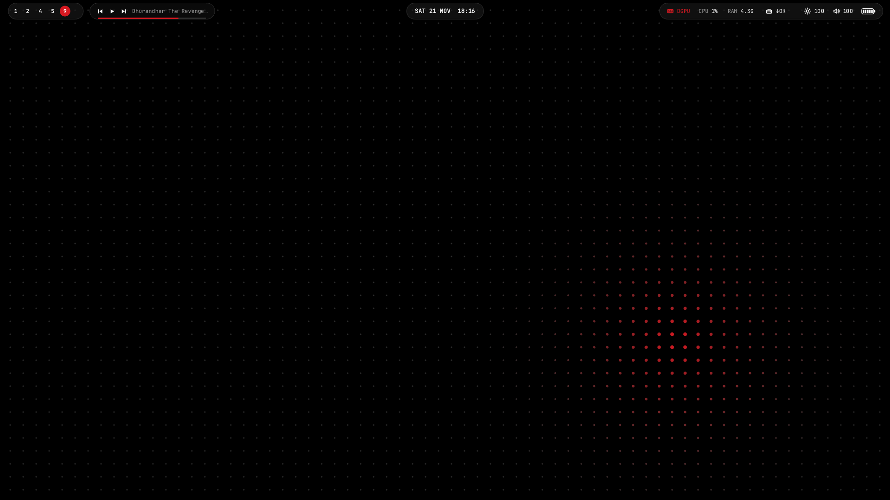

## The bar

Rust, Wayland layer-shell, ~5 MB RAM, draws only while something moves.

| | |
|---|---|
| strip | 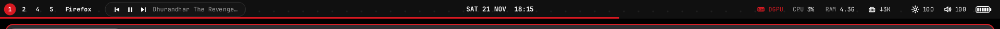 |
| floating | 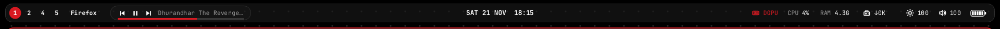 |
| islands | 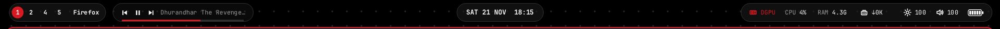 |
| island |  |
| light theme |  |
| frosted | 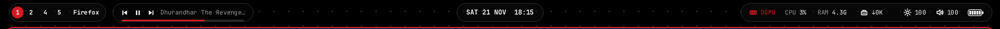 |

Workspace styles: red · block · dot · pill · dots

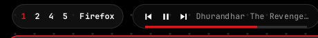 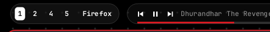 
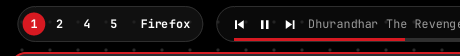 

## Control centre, player, notes, wallpaper

| Control centre | Player (`SUPER+P`) |
|---|---|
| 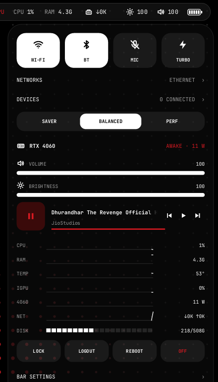 | 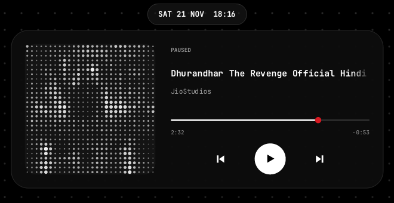 |

| Notes (`SUPER+N`) | Wallpaper (`SUPER+W`) |
|---|---|
| 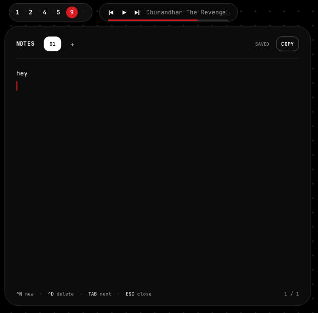 | 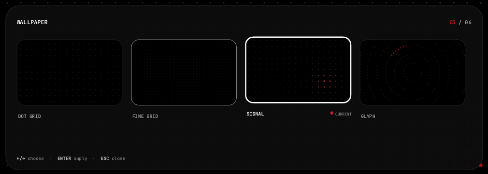 |

## Install (Arch / CachyOS)

```sh
git clone https://github.com/jrush-vj/nothing-os && cd nothing-os
sudo bash install-root.sh   # packages + tuigreet login
bash install.sh             # fonts + ~/.config/hypr (an existing config is moved aside)
```

Log out and in. Bar settings: `~/.config/nothing-bar/config` ([example](bar/config.example)) or BAR SETTINGS in
the control centre. Colours live in `hypr/nothing/palette.lua`.

## Keys

`SUPER+/` shows them all.

| Keys | Action |
|---|---|
| `SUPER+Space` / `SUPER+Return` | launcher / terminal |
| `SUPER+Q` | close window |
| `SUPER+1..0` / `SUPER+SHIFT+1..0` | go to / send to workspace |
| `SUPER+V` | clipboard |
| `SUPER+N` / `P` / `W` | notes / player / wallpaper |
| `SUPER+Escape` / `SUPER+BackSpace` | lock / power menu |
| `SUPER+F12` | turbo: animations off |

## Tests

```sh
cargo test --manifest-path bar/Cargo.toml       # on Linux
HOME=$(mktemp -d) lua test/mock_test.lua hypr   # the whole config against a fake hl API
```

Fonts: Doto, Space Grotesk, Space Mono, JetBrains Mono (SIL OFL).
