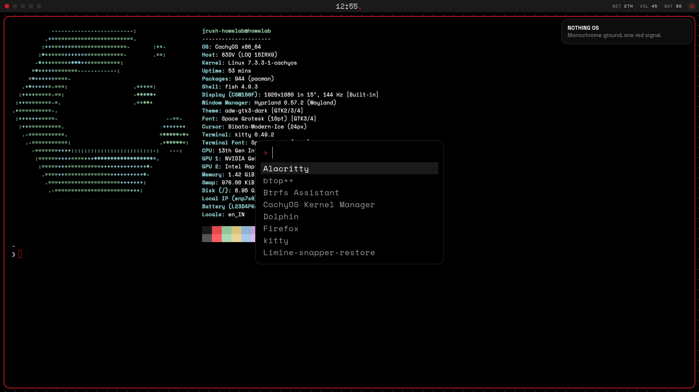
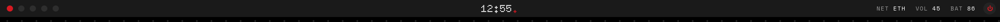

# nothing-os

A Nothing Phone styled Hyprland desktop, written entirely in Lua (Hyprland 0.57+ Lua config).




**Design:** monochrome ground, one red signal. Pure black canvas, grey steps from `#0d0d0d` to `#2e2e2e`,
white text, and Nothing red `#d71921` only for focus and alerts. Dot-matrix display type, uppercase mono labels,
1px lines, no blur, no shadows. Motion is cubic-bezier only (150-300ms, no bounce): opening windows and
reflowing tiles share one curve so nothing overlaps.

| Part | Tool |
|---|---|
| Compositor | Hyprland (Lua config) |
| Bar | Waybar: workspace dots, dot-matrix clock, power disc |
| Launcher, clipboard, power menu, cheatsheet | fuzzel |
| Notifications and volume/brightness OSD | mako |
| Lock / idle | hyprlock, hypridle |
| Wallpaper | swaybg tiling a dot-grid generated by the Lua config |
| Login | greetd + tuigreet |

## One palette, whole desktop

`hypr/nothing/palette.lua` is the only place colours and fonts live. On every load, `hypr/nothing/apps.lua`
renders the Waybar, fuzzel, mako, kitty, hyprlock, hypridle, GTK 3/4 and Qt (kdeglobals) configs and the
wallpaper tile from it. Change a colour, press `SUPER+SHIFT+R`, and everything follows.

## Install (Arch / CachyOS)

```sh
git clone https://github.com/jrush-vj/nothing-os && cd nothing-os
sudo bash install-root.sh   # packages + tuigreet login screen
bash install.sh             # fonts + ~/.config/hypr (an existing config is moved aside)
```

Then log out and in. `install-root.sh` removes the CachyOS Noctalia desktop if present.

## Keys

`SUPER+/` opens a searchable cheatsheet. The essentials:

| Keys | Action |
|---|---|
| `SUPER+Space` | launcher |
| `SUPER+Return` | terminal |
| `SUPER+Q` | close window |
| `SUPER+1..0` / `SUPER+SHIFT+1..0` | go to / send to workspace |
| `SUPER+H J K L` / arrows | focus (add `SHIFT` to move) |
| `SUPER+T` / `F` / `M` | float, fullscreen, maximize |
| `SUPER+S` | scratchpad |
| `SUPER+V` | clipboard history |
| `SUPER+Escape` / `SUPER+BackSpace` | lock / power menu |
| `Print` | screenshot region (saved + copied) |
| `SUPER+F12` | turbo: animations off |

## Live JARVIS wallpaper

The JARVIS holographic core from jarvis-main runs on the Wayland background layer, with a HUD fed live CPU, RAM and
network data. The core's state follows load (idle, thinking above 35% CPU, executing above 70%). Neither renderer's
source is in this repo:

```sh
JARVIS_WALL_RS=~/code/jarvis-main/core/wall-rs bash install.sh   # native (default, WALLPAPER_MODE = "jarvis")
JARVIS_CORE=~/code/jarvis-main/core/web bash install.sh          # WebKit (WALLPAPER_MODE = "jarvis-web")
```

The native one (`jarvis-main/core/wall-rs`) is a Rust + wgpu port of the three.js scene, bloom and HUD. Measured on
the LOQ 15IRX9 (Intel iGPU, 1920x1080 @ 144 Hz):

| | native (Rust, wgpu/Vulkan) | WebKit (`wallpaper/jarvis-wall.py`) |
|---|---|---|
| Render | Intel iGPU only, the RTX 4060 stays asleep | same (Mesa EGL forced) |
| Frame rate | 72 fps at full resolution, locked to every 2nd vblank | 72 fps |
| CPU | ~21% of one core | ~60% of one core |
| RAM | ~145 MB RSS (~60 MB private) | ~630 MB |

Both pause under a fullscreen window and on `SUPER+F12` (turbo). Native knobs: `JARVIS_WALL_MAX_FPS` (120),
`JARVIS_WALL_QUALITY` (`high`/`low`), `JARVIS_WALL_MSAA` (1). Set `WALLPAPER_MODE = "dots"` in `settings.lua` for the
static dot grid.

## Fonts

[Doto](https://fonts.google.com/specimen/Doto) (dot matrix), [Space Grotesk](https://fonts.google.com/specimen/Space+Grotesk)
and Space Mono Nerd Font, all under the SIL Open Font License. Nothing's own Ndot and NType are not included:
they are licensed for Nothing brand materials only. If you own them, set `FONT.dot` in `palette.lua`.

## Test

```sh
HOME=$(mktemp -d) lua test/mock_test.lua hypr
```

Runs the whole config against a fake `hl` API and checks every rendered file, the wallpaper tile and keybinds.
